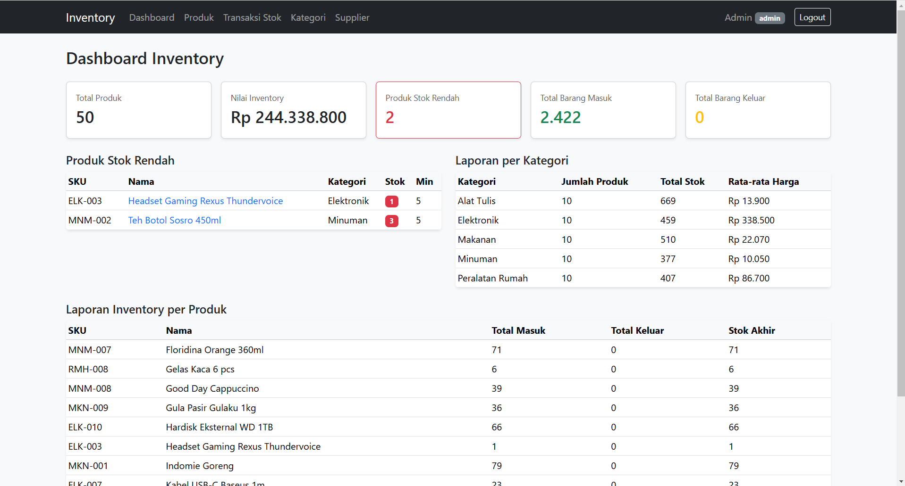
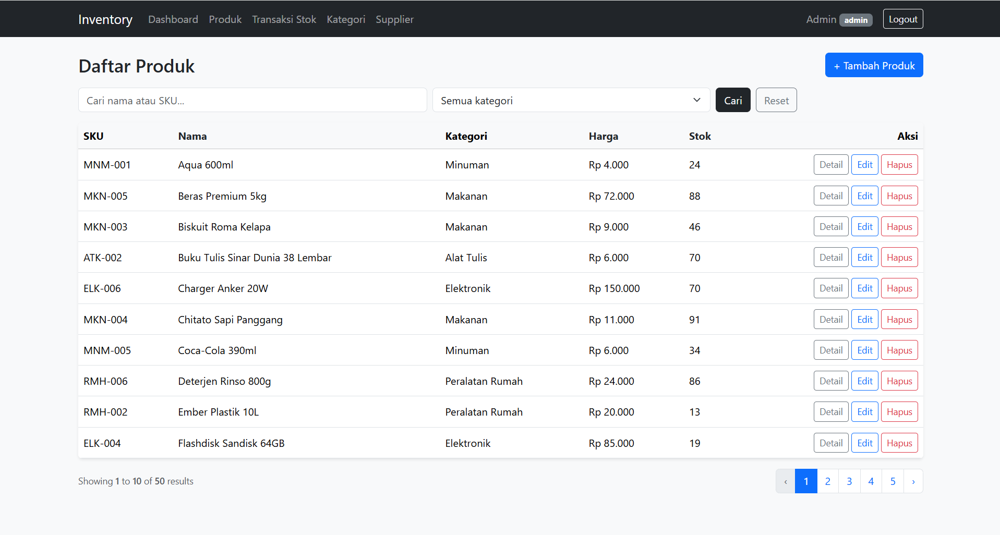
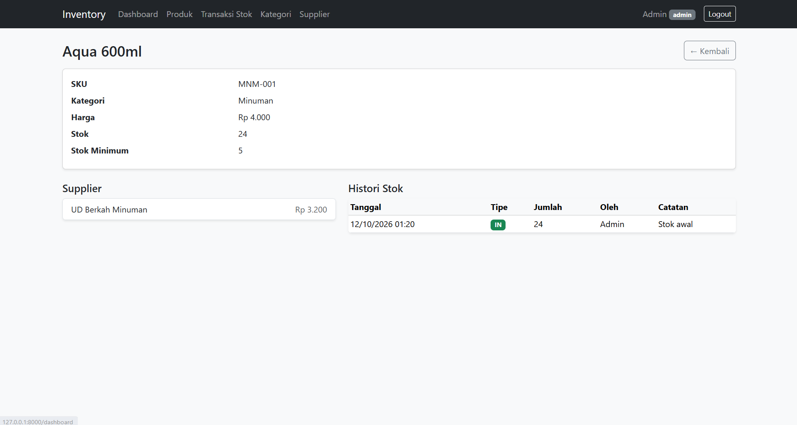
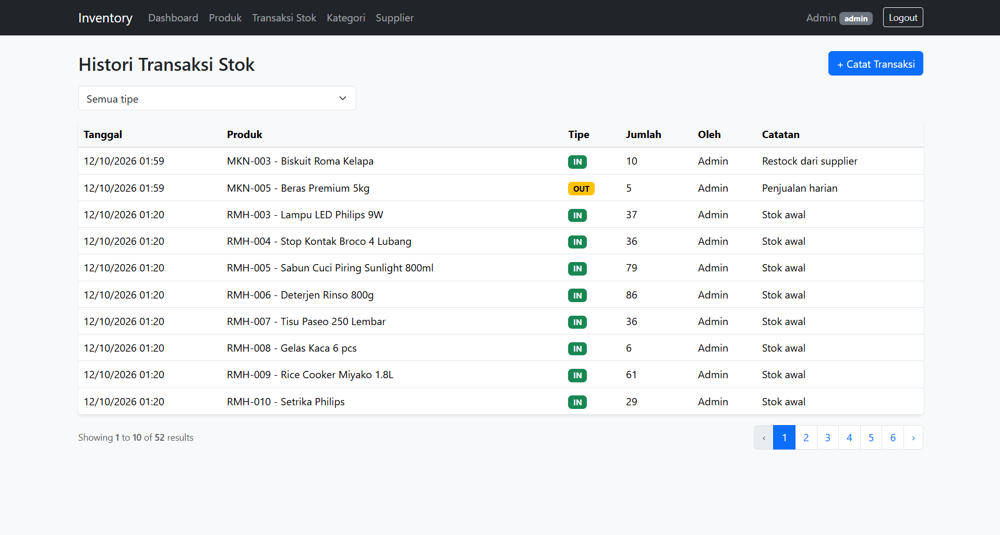

# Inventory Management System (Laravel)

Aplikasi manajemen inventori untuk mengelola kategori, produk, supplier, serta transaksi barang masuk dan keluar, dengan aturan bisnis yang menjaga stok tetap konsisten.

Proyek ini berawal dari mini project kuliah dalam dua tahap: sistem inventori berbasis relational database dan business logic dengan **PHP native**, lalu mengubahnya menjadi aplikasi **Laravel** dengan arsitektur MVC. Seluruh business rule dari versi PHP native dipertahankan, hanya cara mengorganisasi aplikasinya yang berubah.

## Fitur

- Login, logout, dan password hashing (Laravel Auth)
- Role **admin** dan **staff** dengan pembatasan akses di sisi server (middleware)
- Master data: kategori, produk, dan supplier
- Relasi many-to-many antara produk dan supplier
- Transaksi barang masuk dan keluar dengan database transaction
- Daftar produk dengan pencarian (nama atau SKU), filter kategori, sorting, dan pagination
- Dashboard dengan statistik dan laporan inventory (COUNT, SUM, AVG)
- Validasi form dengan pesan error, proteksi CSRF, dan output yang di-escape

## Teknologi

- PHP 8.2+ dan Laravel 12
- MySQL
- Blade (layout, component, form)
- Bootstrap 5 (via CDN)

## Screenshot

| Dashboard | Daftar Produk |
|---|---|
|  |  |

| Detail Produk | Histori Transaksi Stok |
|---|---|
|  |  |

## Instalasi

### Kebutuhan

- PHP 8.2 atau lebih baru
- Composer
- MySQL (misalnya lewat XAMPP)
- Koneksi internet saat membuka aplikasi, karena Bootstrap dimuat dari CDN

### Langkah

1. Clone repository dan masuk ke foldernya:

```bash
git clone https://github.com/USERNAME/inventory-laravel.git
cd inventory-laravel
```

2. Install dependency:

```bash
composer install
```

3. Salin file environment dan buat application key:

```bash
cp .env.example .env
php artisan key:generate
```

   Di Windows PowerShell, `cp` juga dapat dipakai. Alternatifnya: `copy .env.example .env`.

4. Buat database kosong bernama `inventory_db` (misalnya lewat phpMyAdmin).

5. Pastikan konfigurasi database di file `.env`:

```
DB_CONNECTION=mysql
DB_HOST=127.0.0.1
DB_PORT=3306
DB_DATABASE=inventory_db
DB_USERNAME=root
DB_PASSWORD=
```

6. Buat tabel dan isi data contoh:

```bash
php artisan migrate:fresh --seed
```

7. Jalankan aplikasi:

```bash
php artisan serve
```

8. Buka `http://127.0.0.1:8000` di browser.

> Pastikan MySQL sudah berjalan sebelum menjalankan `migrate` dan `serve`, karena session disimpan di database.

## Akun Demo

| Role  | Email                | Password |
|-------|----------------------|----------|
| Admin | admin@inventory.test | password |
| Staff | staff@inventory.test | password |

Akun ini dibuat oleh seeder khusus untuk demo dan pengembangan lokal. Jangan dipakai di lingkungan produksi.

## Data Contoh (Seeder)

- 2 user (admin dan staff)
- 5 kategori: Elektronik, Alat Tulis, Makanan, Minuman, Peralatan Rumah
- 50 produk (10 per kategori) dengan SKU berformat `ELK-001`, `ATK-001`, `MKN-001`, `MNM-001`, `RMH-001`
- 5 supplier, setiap produk terhubung ke 1 sampai 2 supplier
- Stok awal setiap produk dicatat sebagai histori barang masuk ("Stok awal")

## Hak Akses

| Fitur                                  | Admin | Staff |
|----------------------------------------|:-----:|:-----:|
| Dashboard dan melihat produk           | Ya    | Ya    |
| Mencatat transaksi stok (masuk/keluar) | Ya    | Ya    |
| Tambah, edit, hapus produk             | Ya    | Tidak |
| Kelola kategori dan supplier           | Ya    | Tidak |
| Hubungkan atau lepas supplier produk   | Ya    | Tidak |

Pembatasan dijaga di server lewat middleware `auth` dan `admin`, bukan hanya dengan menyembunyikan tombol. Staff yang membuka URL admin langsung akan menerima **403 Forbidden**.

## Arsitektur MVC

Alur request:

```
Request -> Route -> Controller -> Model -> Database -> Response
```

| Komponen   | Tanggung jawab                                                | Contoh di project                                          |
|------------|---------------------------------------------------------------|------------------------------------------------------------|
| Route      | Menghubungkan URL dan HTTP method ke controller               | `routes/web.php`                                           |
| Controller | Menerima request, validasi, memanggil model, memilih response | `ProductController`, `StockMovementController`             |
| Model      | Representasi tabel dan relasi (Eloquent)                      | `Product`, `Category`, `Supplier`, `StockMovement`, `User` |
| View       | Tampilan Blade (layout, component, form)                      | `resources/views/products/index.blade.php`                 |

### Contoh alur: menambah produk

1. Admin membuka `GET /products/create`. Route memanggil `ProductController@create`, lalu controller menampilkan form Blade.
2. Admin mengisi form dan menekan Simpan. Browser mengirim `POST /products` beserta token `@csrf`.
3. `ProductController@store` memvalidasi input (SKU unik, harga tidak negatif, kategori harus ada).
4. Jika validasi gagal, pengguna dikembalikan ke form dengan pesan error dan input lama (`old()`).
5. Jika lolos, `Product::create()` (Model) menyimpan data ke tabel `products` (Database).
6. Controller mengirim `redirect()` ke `products.index` dengan pesan sukses (Response).
7. Daftar produk menampilkan data yang baru disimpan.

### Contoh alur: transaksi barang keluar

1. Pengguna mengirim `POST /stock` dengan produk, tipe `OUT`, dan jumlah.
2. `StockMovementController@store` memvalidasi input.
3. Dalam `DB::transaction()`, baris produk dikunci (`lockForUpdate()`), lalu stok dicek.
4. Jika jumlah melebihi stok, dilempar `ValidationException` dan seluruh transaksi dibatalkan (rollback).
5. Jika cukup, stok dikurangi dan baris histori ditambahkan di tabel `stock_movements`. Keduanya berhasil bersama-sama atau tidak sama sekali.

## Struktur Folder Penting

```
inventory-laravel/
├── app/
│   ├── Http/
│   │   ├── Controllers/
│   │   │   ├── AuthController.php
│   │   │   ├── CategoryController.php
│   │   │   ├── DashboardController.php
│   │   │   ├── ProductController.php
│   │   │   ├── StockMovementController.php
│   │   │   └── SupplierController.php
│   │   └── Middleware/AdminOnly.php
│   └── Models/
│       ├── Category.php
│       ├── Product.php
│       ├── StockMovement.php
│       ├── Supplier.php
│       └── User.php
├── database/
│   ├── factories/
│   ├── migrations/
│   └── seeders/DatabaseSeeder.php
├── resources/views/
│   ├── auth/
│   ├── categories/
│   ├── components/alert.blade.php
│   ├── layouts/
│   ├── products/
│   ├── stock/
│   ├── suppliers/
│   └── dashboard.blade.php
└── routes/web.php
```

## Struktur Database

- `categories` 1 - N `products` (foreign key `category_id`, aturan hapus `RESTRICT`)
- `products` N - N `suppliers` lewat `product_supplier` (composite primary key `product_id` + `supplier_id`)
- `products` 1 - N `stock_movements`
- `users` 1 - N `stock_movements`

## Business Rule

- SKU harus unik.
- Harga dan jumlah tidak boleh negatif.
- Barang keluar tidak boleh melebihi stok, dan stok tidak boleh negatif (validasi di controller dan kolom `unsigned` di database).
- Stok hanya berubah lewat transaksi masuk atau keluar. Setiap perubahan tercatat di `stock_movements` dalam satu database transaction.
- Rumus stok: stok akhir = stok awal + total barang masuk - total barang keluar.
- Produk yang memiliki histori transaksi tidak boleh dihapus.
- Kategori yang masih memiliki produk tidak boleh dihapus.
- Halaman internal membutuhkan login.
- Staff tidak boleh mengakses pengelolaan produk, kategori, dan supplier.
- Sorting hanya memakai kolom dari allowlist (`name`, `price`, `stock`).

## Dari PHP Native ke Laravel

| PHP Native                | Laravel                           |
|---------------------------|-----------------------------------|
| `database/schema.sql`     | `database/migrations`             |
| Form PHP manual           | Blade form + validasi             |
| Query PDO                 | Eloquent                          |
| File CRUD terpisah        | Resource controller               |
| Session manual            | Laravel Auth (`Auth::attempt`)    |
| `include` template        | Blade layout dan component        |
| `password_hash/verify`    | Cast `hashed` dan `Auth::attempt` |
| `beginTransaction/commit` | `DB::transaction()`               |
| `SELECT ... FOR UPDATE`   | `lockForUpdate()`                 |

## Perintah Berguna

```bash
php artisan route:list            # daftar route
php artisan migrate:fresh --seed  # reset database dan isi data contoh
php artisan optimize:clear        # bersihkan cache
```

## Penulis

(isi nama) - [GitHub](https://github.com/USERNAME)
# Mini-Project-3-Inventory-System

